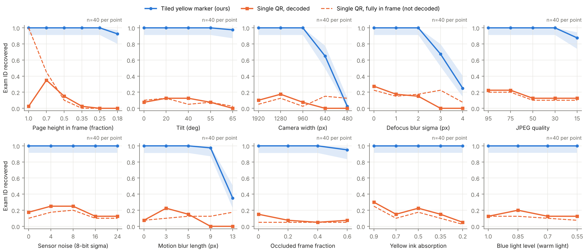

# Exam Registry: a national registry that keeps AI from answering exams in progress

[한국어](README.md) | English

This repository holds the design documents, simulation code and experimental results for a national exam registry that lets cooperating AI services decline to answer questions from exams that are in progress. The plan starts with Korea's national college entrance exam (CSAT), extends step by step to certification exams, university exams and school exams, and is meant to be proposed as an international standard. Anyone can check and reproduce every result by following the steps below.

The proposal was submitted to the Korean Ministry of Education on 15 November 2026 as a public proposal through e-People (국민신문고), the government's national petition and proposal portal. The policy proposal PDF is the version that was submitted. Experiments added after submission (a commercial AI reading test, encrypted lookup checks, registry scale, Korean and number-free items, reading errors, insider guessing, split questions, authority load with test vectors, and the operation walkthrough) are published here.

Contact: Dongwhi Kim (Department of Electrical Engineering, Hanyang University), dongwhi01@hanyang.ac.kr

- Policy proposal (Korean): [`docs/정책제안서.pdf`](docs/정책제안서.pdf)
- Technical specification (Korean): [`docs/설계명세.pdf`](docs/설계명세.pdf)
- Operation walkthrough: [`docs/operation_walkthrough_en.md`](docs/operation_walkthrough_en.md) (English translation of one run), Korean original [`docs/운영과정_시연.md`](docs/운영과정_시연.md)

Background terms
- CSAT: Korea's national college entrance exam (수능), taken by about half a million students on one day each November.
- KICE: Korea Institute for Curriculum and Evaluation (한국교육과정평가원), which sets the CSAT and its mock exams.
- School exams (내신): midterm and final exams set by each school; they count toward university admission.

## 1. Overview

AI services today cannot tell which exam is being held where and when, so they have no way to respond to cheating during exams. The exam registry gives them that information. A school zone speed limit applies only to the roads around a school and leaves every other road alone; in the same way, the registry acts only on registered exam items, and only while the exam is running.

1\. Registration: before the exam, an accredited exam authority signs the exam name, the time window of each period and a hash of the items (a one-way digest from which the items cannot be recovered), and registers them in the national registry, a public append-only log. The item text itself is not registered.

2\. Two keys: during a registered window, a cooperating AI service checks whether an input photo or text matches an exam in progress, in the two ways below, and declines to answer if it does. Either key is enough to refuse, so each key covers inputs the other cannot check.

a. Content lookup (core): the service cuts the input text into 4-character pieces and looks them up at the exam authority's server in blinded form (an oblivious pseudorandom function, as in IRTF RFC 9497). The authority never sees the user's input and the service never sees the item text. Section 3.5 checks that the encrypted lookup gives the same decisions as plain matching.

b. Exam page marker (supplement): a faint yellow security pattern carrying the exam ID is printed in the background of the exam page. It repeats a small grid marker (ArUco), so the exam ID can be read even from a photo of part of the page. Decoding runs inside the AI service and needs no outside call. On-device AI that runs without internet cannot use the content lookup, so it is covered only where phone and glasses makers receive the list of registered windows in advance and build the marker decoder into the device.

3\. Automatic release and audit: the restriction ends when the registered window ends. After the exam the items are published, and anyone can compare them with the registered hash to confirm that nothing but the exam items was blocked.

4\. Refusal, not detection: a match only makes the service decline to answer. By default nobody is identified or reported; only the number of refusals per exam is counted. Tracing a classroom or reporting a person is left as a separate option for the government to decide.

### Who does what

| Role | Party |
|---|---|
| Accrediting registering authorities, compliance requirements for AI services in education | Ministry of Education |
| Running the national registry and the shared lookup server | An education information system operator designated by the state |
| Registering and signing exams, printing the marker | Exam authorities (KICE for the CSAT and mock exams, the administering body for certification exams) |
| Registering school and university exams | Teachers accredited by the regional office of education or the university; they use the shared lookup server and need no server of their own |
| Deciding, refusing, reporting refusal counts | Cooperating AI services |
| Marker decoding in on-device AI | Cooperating phone and glasses makers |

Chapter 7 of the policy proposal describes the procedures and how cooperation is requested.

Once the state builds this system and takes charge of accreditation and management, the same registration format can cover not only national exams but certification exams, university exams, school exams and online exams. Each country can run its own registry in the same format, and registries can be linked.

## 2. Try it (about five minutes)

### 2.1 Setup

Python 3.10 or later. In a terminal (Command Prompt on Windows), go to the repository folder and run:

```
pip install -r requirements.txt
cd code
```

A Korean font is needed for the simulated exam pages. Windows (Malgun Gothic), macOS (Apple SD Gothic Neo) and Linux (Noto Sans CJK) are found automatically. Otherwise set the environment variable `EXAM_FONT` to the path of a Korean font file.

### 2.2 Demo

```
python demo.py --en
```

Runs exam registration and signature checking, decoding of the marker from a partial photo of a marked exam page, and the content lookup. Output:

```
[1] Exam registration
    Registered record: {"exam_id": "5A17C0DE", "title": "2027학년도 모의 시험 수학 영역", "policy": "content_match"}
[2] Exam page marker
    Photo of the marked exam page: exam ID 5A17C0DE read (6/6 chunks) -> during the exam refused, after it normal answer
    Photo of the unmarked exam page: no marker -> normal answer
[3] Content lookup
    Item as printed: pieces matched 100%, numbers match yes -> refused
    Spacing and wording changed: pieces matched  91%, numbers match yes -> refused
    Same type, different numbers: pieces matched  40%, numbers match no -> normal answer
    Unrelated question: pieces matched   0%, numbers match no -> normal answer
```

The marked page (`page_marked.png`) and simulated photos (`photo_marked.png`, `photo_unmarked.png`) are saved in `demo_out/`. You can change the marker strength and the photographed area:

```
python demo.py --en --ink 0.5 --view 0.25
```

`--ink` is the share of blue light absorbed by the yellow ink (print strength); `--view` is the photographed height as a share of the page height. Without `--en` the output is in Korean.

### 2.3 Operation walkthrough

```
python operation_demo.py
```

Plays one mock exam day from preparation two months ahead to the audit after the exam. The Ministry, a regional office of education, the registry operator, the exam authority, the printer, an AI service, a device maker and an auditor each act only on the information they hold (about 15 seconds).

1. Preparation: the Ministry designates the registry operator, accredits KICE directly, and delegates school accreditation to an office of education. Agreements are signed with an AI service and device makers.
2. Compliance test: a 30-minute test exam is registered to check that the AI service refuses only during the window.
3. Exam preparation: items are frozen, an unused exam ID is confirmed in the log, item pieces are encrypted, the papers are printed, and a printed sample is checked with the decoder.
4. Registration and distribution: a signed record is registered; an unaccredited group, a school registering a CSAT-type exam, a duplicate ID, a record changed in transit and a 30-hour block are rejected. Schools register without revealing their items by having pieces encrypted through the shared lookup server. The operator signs the log head. Encrypted piece sets are distributed locked; the AI service re-verifies the log and stores the locked sets, so an insider has nothing to compare guesses with (3.9). The device maker pushes only exam IDs and windows under its own signature, and a list with an extra exam slipped in is refused. Anyone can see which exams will be blocked the next day.
5. Exam day: set keys are released and the sets opened at the start (a tampered set is discarded); photos and text before, during and after the exam; on-device AI; an attempt to register after the start.
6. After the exam: the items and the commitment secret are published and checked, the log chain is verified, and refusal counts per exam are reported.

Each step prints who acted, what that party saw and what it did not see. Decisions are computed, not scripted, and are the same on every run. The script prints Korean; an English translation of one run is in [`docs/operation_walkthrough_en.md`](docs/operation_walkthrough_en.md). Results are written to `operation_demo_out/` as a timeline (`operation_demo.html`, `operation_demo.md`) and photos.

### 2.4 Check the numbers quoted in the documents

```
python summarize_results.py --en
```

Computes every number quoted in the policy proposal and the specification directly from the raw data in `results/` and prints it.

## 3. Results and how to reproduce them

All experiments are computer simulations that model printing and photographing numerically. The random seed of each trial is derived from the name of its condition, so the same command gives the same result. Run times are for one ordinary laptop.

| Item | Result | Command (in `code/`) | Time |
|---|---|---|---|
| Marker decoding (2,835 trials) | 0 read as a wrong exam ID, 0 ordinary documents taken as marked. 100% decoded from a photo of 25% of the page height, 93% at 18% (a single corner code: 0% at both) | see 3.1 | about 2 h (photographed area only: about 7 min) |
| Refusal by signed time window | 60/60 refused inside the window, none outside it, 0 of 500 ordinary pages refused. Forged signature, unaccredited authority, window over 24 h and retroactive registration all rejected | `python e2_protocol.py` | about 15 min |
| Piece matching with number check | 0% of same-type practice problems refused, 97 to 100% of rewritten questions detected (test items, threshold 0.5) | `python e3_registry.py` | seconds |
| Photos whose text is readable but whose marker is not (1,152 photos) | 33 with full decoding only, 0 with the final decoder. Final decoder on ordinary documents: 0/152 false matches | see 3.2 | about 30 min |
| Can a commercial AI read them (36 photos) | Every photo the AI solved (10) also had a readable marker. The AI solved none of the 22 photos whose marker could not be read | `python e5_stage2_score.py` | seconds |
| Real exam page | Lowest print strength currently decodable: 50% | see 3.3 | about 5 min |
| Encrypted content lookup | Same decision as plain matching with the same rule on all 600 queries. Per question about 13 ms at the authority and about 53 ms in total at the service (demonstration implementation, one CPU) | `python e7_oprf_lookup.py` | about 1 min |
| Registry grown to 60,000 items | Detection of rewritten questions stays at 99.4%. Practice problems refused: 1/240 from 6,000 items with the E7 rule, 0/240 up to 60,000 with a revised rule that counts repeated numbers | `python e8_registry_scale.py` | about 30 s |
| Korean items, items without numbers | The earlier rule refused 0% of number-free text items. The proposed rule refused 100% of 480 rewritten questions, 0/240 practice problems, 0/10 stems typed alone. Korean word problems: 99.7% (on new items) | `python e9_korean_text_items.py` | about 1 min |
| Reading errors in photos | At a 5% character error rate, 100% of text items and 70 to 76% of word problems refused. A single misread digit lets a word problem through. 0/720 practice problems refused at every error rate | `python e10_reading_errors.py` | seconds |
| Can an insider at an AI service learn the items before the exam | With open sets, an insider who knows how the items were generated rebuilds all 120 Korean items from 18,605 guessed pieces (about 140 ordinary questions). With sets distributed locked and the key released at the start: 0 matches before the start | `python e11_insider_guessing.py` | about 1 min |
| Questions split across messages | Verbatim splits are all refused. With numbers replaced by letters and the values sent separately, judging each message alone refuses 0 to 58% of Korean word problems; judging the whole conversation and putting values such as "A=168" back refuses 97 to 100%. 0 of 1,200 study conversations refused | `python e12_split_questions.py` | seconds |
| Authority load, test vectors for integration | In this implementation one CPU core serves about 40 Korean questions per second; batching does not lower the cost per piece. Piece values and 7 decisions under a fixed public test key are published | `python e13_load_and_vectors.py` | about 20 s |



### 3.1 Marker decoding

```
python e1_sim.py --trials 40 --grid 15 --mixed 250 --seed 20261115 --out e1_main
python e1_sim.py --factors "" --grid 0 --mixed 250 --seed 777 --out e1_seed777
python e1_merge.py e1_main e1_seed777
python e1_plot.py E1-005_results_v2_merged.json
```

To check only the photographed-area sweep, run `python e1_sim.py --trials 40 --grid 0 --mixed 0 --factors view --out e1_view`. The result matches the corresponding rows of `results/E1-005_results_v2_merged.json`.

### 3.2 Photos whose text is readable but whose marker is not

Needs Tesseract OCR with Korean and English language data (Windows: UB Mannheim build, macOS: `brew install tesseract tesseract-lang`, Linux: `tesseract-ocr-kor`).

```
python e5_legibility.py --seed 5050 --out e5_s5050
python e5_legibility.py --seed 6060 --out e5_s6060
python e5_collect.py e5_s5050 e5_s6060
NP=40 python e5_fp2.py highlighter
NP=20 python e5_fp2.py sticky
NP=8 python e5_fp2.py blocks
NP=8 python e5_fp2.py texture
```

Each photo is read in two ways: by the marker decoder an AI service would use, and by OCR, which reads the question text in the photo. The experiment counts photos whose text can be read while the marker cannot. On Windows Command Prompt use `set NP=40` and then `python ...` instead of `NP=40 python ...`.

#### Rechecked with a commercial AI (E5-003)

The same question was checked with a commercial AI, which reads photos better than OCR. 36 photos from 3.2 were chosen by a rule fixed before any photo was shown to the AI (header of `code/e5_stage2.py`): the 20 photos where the final decoder failed (largest text first), 2 repeats of those, 10 small-text photos only the final decoder could read, and 4 clear control photos. For each photo, ChatGPT (model shown on screen as GPT-Astra) was asked for the question number, the text it read and the answer.

| Group | Photos | Solved by the AI | Marker decoded |
|---|---|---|---|
| Final decoder could not read the marker (2 repeats included) | 22 | 0 | 0 |
| Small text, read only by the final decoder | 10 | 6 | 10 |
| Clear controls | 4 | 4 | 4 |

Every photo the AI solved also had a readable marker, so a cooperating service would have refused it. Conversely, in 4 photos with text about 6 pixels high the AI could not read the text while the marker was decoded. Photo 9 was first answered from the content of the same exam page (the same question 1) shown just before in the same chat; asked again in a new chat with that photo alone and two different prompts, it was unreadable both times. Answers are scored automatically by regenerating the items from the page ID in each photo. Photos, answer key, prompts and raw responses are in `results/E5-003_*` (prompts in Korean).

```
python e5_stage2_score.py
```

### 3.3 Real exam page

The original exam paper is not included for copyright reasons. The published result was obtained on page 1 (A3) of the Korean language section of the 2026 CSAT, which can be downloaded from KICE's website. Save the first page of the exam PDF as a 150 dpi image `page.png` and run:

```
python e6_make_sample.py
python e6_check_decode.py 0.7 0.5 0.35 0.2 0.12
```

The first command saves sample images with the marker (`sample_ink70.png` and so on); the second prints decoding results for 10 simulated photos per print strength.

### 3.4 How the content lookup works

```
python oprf_demo.py
```

Shows in a few lines how a lookup works in which the authority cannot see the user's input and the service cannot see the item text. It explains the principle and is not an RFC 9497 implementation. A real deployment should use a vetted library that follows RFC 9497.

### 3.5 Does encryption change the decisions, and how long does it take

```
python e7_oprf_lookup.py
```

Regenerates, in the same order as E3, the same 60 test items, 360 automatically rewritten questions and 240 practice problems of the same types. The same rule (at least half of the question's 4-character pieces found in one item, and every number in the question present in that item) is applied in two ways:

- Control (plain matching): pieces compared as hashes, without encryption
- Encrypted lookup: pieces looked up at the authority while blinded, with a 2HashDH construction on the P-256 curve

All 600 queries get the same decision, the same matched item and the same match share under both. Detection of rewritten questions and the false refusal rate on practice problems (0%) are also the same as in E3. Decisions are the same on every run; timings depend on the machine. This implementation only shows the processing cost and is not RFC 9497 (the hash-to-curve method and encodings differ).

### 3.6 A larger registry (E8)

```
python e8_registry_scale.py
```

When many schools register exams on the same day, as in midterm weeks, the registry holds tens of thousands of items. The registry was grown from 60 to 600, 6,000 and 60,000 items and the same 600 queries of 3.5 were judged again. All added items come from the same 12 templates as the practice problems, so the registry fills with items similar to what students practise: the least favourable case. At 60 items the decisions were first checked to be identical to the plain matching of 3.5 on all 600 queries.

| Registered items | Rewritten questions detected | Practice refused (E7 rule) | Practice refused (revised rule) |
|---|---|---|---|
| 60 | 99.4% | 0/240 | 0/240 |
| 600 | 99.4% | 0/240 | 0/240 |
| 6,000 | 99.4% | 1/240 | 0/240 |
| 60,000 | 99.4% | 1/240 | 0/240 |

The E7 rule checks each distinct number in the question once. A practice problem in which the same number appears twice ("first term 68, ratio 68") was therefore matched to another registered item containing 68 only once. With the revised rule, a repeated number must appear the same number of times in the registered item; there were then no false refusals up to 60,000 items and detection was unchanged. The revised rule is recommended for operation and is used in the demonstration code (`demo.py`, `oprf_demo.py`, `operation_demo.py`); the demonstrations' decisions did not change. A variant that checks every item above the threshold instead of only the best-matching one was also compared and rejected, because it raised false refusals (3 to 5 at 60,000 items). The result file records the text of each refused practice problem and of the registered item it matched.

### 3.7 Korean items and items without numbers (E9)

```
python e9_korean_text_items.py
```

The items in 3.5 and 3.6 were all English word problems. And because the rule required the question's numbers to appear in the registered item, items without numbers, as in Korean language or social studies, could not be protected by the content lookup. This experiment registers 60 English word problems, 60 Korean word problems and 60 Korean multiple-choice text items without numbers (a stem, a passage of 4 to 6 sentences and choices ① to ⑤) together and compares three rules:

- E8 rule: the revised rule of 3.6 as it is
- Naive extension: a question without numbers is refused if at least half of its pieces match
- Proposed rule: when registering, the authority marks the pieces of the item's stem (the question line, such as "Which of the following best states the main idea?"). For a question without numbers (or with only choice numbers 1 to 5), the stem pieces are removed, and the question is refused only if at least 20 of the remaining pieces match one item and their share reaches a set level. ① and 1) are treated as the same character. A question with any other number is judged by the E8 rule.

The share for text questions was chosen on one set of items (the lowest value with no practice problem refused: 0.6), then fixed and tested on newly generated items. The table shows the new items. Practice problems were made from the same stems, the same vocabulary and the same 30 sentence frames as the registered items.

| Item type | Question | E8 rule | Naive extension | Proposed rule |
|---|---|---|---|---|
| Korean text items | 480 rewritten questions refused | 0% | 100% | 100% |
| | Practice problems refused | 0/240 | 0/240 (2/240 on the selection set) | 0/240 |
| | Stem typed alone, refused | 0/10 | 10/10 | 0/10 |
| Korean word problems | 300 rewritten questions refused | 100% | 100% | 99.7% |
| | Practice problems refused | 0/240 | 0/240 | 0/240 |
| English word problems | 360 rewritten questions refused | 99.4% | 100% | 99.4% |
| | Practice problems refused | 0/240 | 0/240 | 0/240 |

Rewrites of text items include reordered sentences, partial copies, synonyms, choice marks typed as 1), choices left out, and the passage alone. The naive extension refuses a stem such as "Which of the following best states the topic of the passage?" typed on its own, so it cannot be used; the proposed rule removes the stem pieces and does not. The 3 questions the proposed rule let through are short quotes such as "+ 3, find the value of f(2).", with fewer than 20 pieces and only numbers of 5 or less. With only the 60 English items registered, the E8 rule was first checked to give the same result as 3.6 at 60 items.

The proposed rule uses only set operations on piece values, so it can run on encrypted piece values as well. Every 5th question, 386 in all, was judged again with the encrypted lookup of 3.5, and every decision was the same.

Questions with the same passage but a different stem and different choices were refused in 59 of 60 cases. The passage itself is exam content, so during the exam other questions quoting the same passage are refused too.

### 3.8 Reading errors in photos (E10)

```
python e10_reading_errors.py
```

When a service receives a photo it first reads the text and then looks it up. To see what reading errors do, copies of the registered items of 3.7 had characters replaced, dropped or doubled at a set rate and were judged with the proposed rule (3 copies per item, 720 practice problems once each).

| Character error rate | English word problems refused | Korean word problems refused | Korean text items refused | Practice refused |
|---|---|---|---|---|
| 0% | 100% | 100% | 100% | 0/720 |
| 1% | 92.2% | 92.8% | 100% | 0/720 |
| 2% | 85.0% | 90.0% | 100% | 0/720 |
| 5% | 76.1% | 70.0% | 100% | 0/720 |
| 10% | 56.1% | 50.0% | 87.2% | 0/720 |
| 15% | 24.4% | 28.9% | 10.0% | 0/720 |
| 20% | 12.8% | 12.2% | 0% | 0/720 |

Text items were all refused up to a 5% error rate. A word problem fails the number check if a single digit is misread, so about 7% were missed even at 1%. Loosening the number check would refuse practice problems that differ only in their numbers (3.6), so the rule was not changed. This is why word problems arriving as photos need the exam page marker (3.1 to 3.3), which does not depend on reading the text. Errors only ever reduced refusals; no practice problem was refused.

### 3.9 Guessing by an insider at an AI service (E11)

```
python e11_insider_guessing.py
```

A cooperating AI service receives the encrypted piece sets of the registered items and, as in every lookup, can have any piece encrypted by the authority's server. So someone inside the service could guess pieces, have them encrypted, and check whether they are in a set, possibly rebuilding the items before the exam. The attacker was made as strong as possible on purpose: an insider who knows the exact generator of the test items (sentence frames, names, stems, topics, nouns) and lacks only the values that were drawn. Real item writers do not publish their templates, so a real attacker is weaker. Targets: the 60 Korean word problems and 60 Korean text items of the new set in 3.7.

| Measure | Result |
|---|---|
| Number guesses (0 to 999, with repetitions, 3,000 in all) | Every number of all 120 items recovered |
| Word problems rebuilt completely | 60/60 |
| Stems, passage sentences and choices of text items recovered | 60/60 (all 651 sentences) |
| Distinct pieces guessed | 18,605, about 140 ordinary questions at 132.6 pieces each, about 0.1 CPU minutes at the authority |
| Checked directly on encrypted values | Same result as plain matching for all 2,100 guesses |

The guessing needed is only about 140 ordinary questions' worth, so in a service with many users it cannot be caught by rate limits or anomaly detection. The sets therefore must not be open before the exam. Distributing the sets a day ahead, locked with AES-256-GCM, and releasing the 32-byte key when the exam starts was tested as well: before the start 0 of 200 guesses matched, and after the key was released the sets opened to exactly the original values. The operation walkthrough (2.3) now works this way. While the exam is running an insider could still learn the items the same way, but by then every candidate already has the exam paper.

### 3.10 Questions split across messages (E12)

```
python e12_split_questions.py
```

A message with few pieces may fall below the threshold, so questions split into several messages were tested, with the 180 new items of 3.7 and the proposed rule unchanged.

- Verbatim split: the item cut into 2, 4 or 8 consecutive word chunks, sent one by one
- Numbers apart: numbers replaced by A, B, C, the text cut into 1, 2, 4 or 8 chunks, then "A=168, B=75, C=4" sent last

| Attack | Judged | English word | Korean word | Korean text |
|---|---|---|---|---|
| Verbatim split (2 to 8 parts) | each message | 100% | 100% | 100% |
| Numbers apart (text in 1 part) | each message | 92% | 58% | 100% |
| Numbers apart (text in 8 parts) | each message | 0% | 0% | 100% |
| Numbers apart (text in 8 parts) | whole conversation | 92% | 58% | 100% |
| Numbers apart (text in 1 to 8 parts) | whole conversation, values put back | 97% | 100% | 100% |

Verbatim chunks, however short, are exact copies of part of a registered item and were all refused. With the numbers sent apart, word problems mostly passed when each message was judged alone. Judging all messages of the conversation together during the exam, and putting values given as "A=168" back in place of the letter (a plain text substitution with no understanding of the problem), refused 97 to 100%. The 3% missed among English word problems are cases where the article "A" in the text collided with the placeholder letter. 600 conversations asking four practice problems of the same type in a row, and 600 mixing practice problems, stems and short follow-up questions, were not refused under any way of judging.

### 3.11 Authority load and test vectors (E13)

```
python e13_load_and_vectors.py
python e13_load_and_vectors.py --check
```

The authority's only work per question is one elliptic-curve multiplication per piece. On one CPU core of this machine, processing pieces in batches of 1, 70, 1,000 and 10,000 took about 163 to 188 microseconds per piece, almost independent of the batch size. Batching does not lower the server cost, which is proportional to the number of pieces. At the median Korean question (132 pieces) one core serves about 43 questions per second, and about 84 for English questions (67 pieces). For an assumed 1,000 Korean questions per second this implementation would need about 24 cores. On the service side, blinding and unblinding one Korean question took about 105 ms.

So that a service can check its own implementation, values made with a public test key (never used for a real exam) are in `results/E13-test_vectors.json`: the pieces and number tokens of 3 items (2 word problems, 1 text item), the encrypted value of each piece, the stem pieces, and the pieces and decisions of 7 queries (item as printed, spaces removed, practice problem with different numbers, repeated number, text item as printed, stem alone, choice marks typed as 1)). `--check` recomputes the values and confirms they are unchanged.

## 4. Reading the results

- All results are simulations. Measurements with real cameras and real printed pages are tasks for the pilot stage.
- The final decoder (partial decoding with upscaling and sharpening) was improved after inspecting the results of 3.2. The pre-improvement result (33 photos) is published as well.
- On the test page the marker was decoded even at low print strength, but on a real exam page dense with text and figures the lowest decodable strength is currently 50%. The goal is a strength barely visible to the eye (`figures/sample_target_faint.png`), which needs further research.
- The accuracy of the content lookup was evaluated only on test items made for the experiments. The "rewritten questions" of E3 and 3.5 apply automatic changes to spacing, number formatting, sentence order, partial excerpts and word substitution. Questions completely reworded by hand are detected only to a limited extent.
- The E8 items are test items built from 12 English sentence templates. They should be checked again on real exam items and real study questions. The matching time in E8 (about 40 ms per question at 60,000 items) was measured with a simple implementation and grows with the number of registered items.
- The number-free rule of E9 is a proposal verified in the experiment code and is not yet used in the demonstration code (`demo.py`, `operation_demo.py`), whose items all contain numbers. The text items are test items built from sentence frames and should be checked again on real passages and real study questions. The share of 0.6 was chosen on these test items. The minimum of 20 pieces made no difference in this experiment (the same result from 0 to 30).
- Under E9, a quote of 20 or more pieces that matches a registered item exactly is refused even without its numbers; a practice problem with the same sentence frame typed without its numbers is one such case. A question with the same meaning in entirely different words cannot be caught by piece matching.
- The reading errors of E10 come from a simple model in which each character fails independently. The error rate and error patterns of real services reading photos were not measured.
- The locked sets of E11 prevent leaks before the exam starts but not guessing by an insider during the exam. How the key is delivered reliably at the start (for example published in the log under a signature) is left to the operational design. The guessing cost for a realistic attacker who does not know the item templates was not measured.
- The value restoration of E12 handles only the "A=168" form. Numbers written in Korean words, or values described in words such as "the first value is 168", remain a limit, like synonyms. Judging the whole conversation requires the service to hold the conversation briefly during the exam.
- The throughput of E13 is that of the Python demonstration. Optimized cryptographic libraries may be faster; this was not measured. During exam windows every text question sent to a cooperating service is subject to lookup, so actual question volumes in weeks crowded with school exams should be checked together with the services. Whether to answer or refuse when the authority's server is down must also be decided in the operational design.
- The timing of the encrypted lookup was measured on the demonstration implementation with one CPU. Throughput at operating scale has to be measured after the shared lookup server is built.
- The commercial AI test covers one model (GPT-Astra) and 36 photos. The exact text of the first-round prompt was not kept (`results/E5-003_prompts.md`). It should be checked again when the model changes.
- With very different library versions, image processing results may differ in a few trials. The tested versions are listed in `requirements.txt`.
- A local AI set up by the user, services that do not cooperate, and solving by another person cannot be stopped by this proposal; they remain the job of existing enforcement and invigilation.

## 5. Repository layout

| Path | Contents |
|---|---|
| `code/demo.py` | Five-minute demo (`--en` for English output) |
| `code/operation_demo.py` | Operation walkthrough by role (Korean output) |
| `code/summarize_results.py` | Prints every number quoted in the documents (`--en` for English output) |
| `code/e1_sim.py`, `e1_merge.py`, `e1_plot.py` | Marker printing, capture and decoding simulation |
| `code/e2_protocol.py` | Exam registration, signatures, refusal by time window |
| `code/e3_registry.py` | Piece matching with number check |
| `code/oprf_demo.py` | Principle of the blinded content lookup |
| `code/e7_oprf_lookup.py` | Encrypted lookup vs plain matching, timing |
| `code/e8_registry_scale.py` | Detection and false refusals as the registry grows |
| `code/e9_korean_text_items.py` | Rules for Korean items and items without numbers |
| `code/e10_reading_errors.py` | Decisions under reading errors |
| `code/e11_insider_guessing.py` | Insider guessing and locked distribution |
| `code/e12_split_questions.py` | Split questions and judging whole conversations |
| `code/e13_load_and_vectors.py` | Authority load, making and checking test vectors |
| `code/e5_legibility.py`, `e5_enh.py`, `e5_collect.py`, `e5_fp.py`, `e5_fp2.py` | Text reading vs marker decoding, final decoder, false matches on ordinary documents |
| `code/e5_stage2.py`, `e5_stage2_score.py` | Photos for the commercial AI test and scoring |
| `code/e6_make_sample.py`, `e6_check_decode.py` | Real exam page |
| `results/` | Raw results (E1 to E13 follow the order above) |
| `figures/` | Result figures, sample test pages |
| `docs/` | Policy proposal and specification (Korean), operation walkthrough (Korean and English) |

## 6. Not included

- Original exam papers and sample images made from them (copyright)

## 7. License

Apache License 2.0
